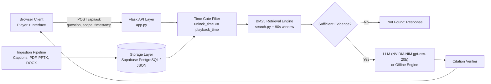

# LearnMate

A timestamp-aware interactive learning assistant for recorded lectures. A learner pauses a video, asks a question, and receives an answer grounded strictly in the content unlocked up to the current playback position, with verified citations. If the lecture material does not support an answer, the system returns a refusal rather than hallucinating.

Team Syntax Surge | AHGV BuildVerse 2026 | Industry Problem Statement 1: AI-Powered Interactive Learning Assistant

Live Application: https://learnmate-xnq2.onrender.com/  
(Hosted on Render free tier with Supabase PostgreSQL. The first request after a period of inactivity may take up to 50 seconds to spin up.)

---

## Features

- Playhead-gated question answering: Video transcript cues and document pages are filtered by unlock timestamp before retrieval. Content appearing after the current playback position is never passed to the model.
- Unified multi-resource retrieval: Video captions (YouTube auto-sync or uploaded .srt/.vtt files), PDF lecture notes, PowerPoint slide decks (.pptx), Word files (.docx), and text notes share a single retrieval layer.
- Verified citations: Only sources actually retrieved in context are shown to the user. Citations link directly to video timestamps (which seek the player on click), PDF page numbers, or slide indices.
- Hallucination control: Queries lacking sufficient supporting context return a structured "not found" response without querying the language model.
- Study synthesis: Generates progressive summaries, key revision notes, concept comparisons, and multiple-choice quizzes with grounded answer rationales.
- Adaptive mock interview: Evaluates user responses and dynamically poses follow-up questions to probe conceptual gaps. Generates an explainable scorecard with covered points, missed concepts, and scoring criteria.
- LMS interoperability: Provides endpoints for simulated LMS user launch and gradebook progress export (POST /api/lms/launch and GET /api/lms/export/<course_id>).
- Direct document inspection: Bundled and uploaded course documents can be viewed, outlined, and downloaded directly within the workspace.
- Offline demo mode: Fully functional without an API key using deterministic sentence extraction against indexed course material.

---

## Architecture



Detailed design, concurrency isolation, and AWS service mapping: [docs/ARCHITECTURE.md](docs/ARCHITECTURE.md)

---

## Technology Stack

- Backend: Python 3.11+, Flask 3.0, Gunicorn (2 worker processes)
- Frontend: Vanilla JavaScript (ES6+), HTML5 Video API, CSS3
- Document Parsing: PyMuPDF (PDF), python-pptx (PowerPoint), youtube-transcript-api (YouTube captions)
- Search: Inverted-index BM25 keyword retrieval with timestamp-bounded sliding window
- Persistence: Dual-mode storage adapter (serverless Supabase PostgreSQL in production, local JSON for offline testing)
- Inference: NVIDIA NIM API (openai/gpt-oss-20b) or any OpenAI-compatible completions endpoint, with token-bucket caching

---

## Setup and Execution

### Prerequisites
- Python 3.11 or higher
- Git

### Installation

```bash
# 1. Clone the repository
git clone https://github.com/skavyansh15/LearnMate.git
cd LearnMate/learnmate

# 2. Create and activate a virtual environment
python -m venv .venv

# On Windows:
.venv\Scripts\activate
# On macOS/Linux:
source .venv/bin/activate

# 3. Install dependencies
pip install -r requirements.txt

# 4. Optional: Set up environment variables
cp .env.example .env

# 5. Start the local server
python app.py
```

Open http://127.0.0.1:5000 in a browser. If LLM_API_KEY is omitted, the application runs in offline demo mode using the bundled sample lecture.

---

## Configuration

All configuration is managed via environment variables. Refer to .env.example for reference defaults.

| Variable | Description | Default |
| :--- | :--- | :--- |
| LLM_API_KEY | Provider API key. Empty string enables offline demo mode. | "" |
| LLM_BASE_URL | Base URL for OpenAI-compatible endpoint | https://integrate.api.nvidia.com/v1 |
| LLM_MODEL | Target language model identifier | openai/gpt-oss-20b |
| DATABASE_URL | Optional PostgreSQL / Supabase connection URI for cloud persistence | "" |
| SECRET_KEY | Flask session cryptographic signing key | Random 64-character hex |
| COOKIE_SECURE | Set to 1 when serving over HTTPS | 0 |
| DAILY_AI_CALLS | Per-user daily budget for live AI queries before falling back to demo extraction | 100 |
| RATE_PER_MIN | Rate limit per user per minute | 30 |
| DATA_DIR | Local storage directory when database is unconfigured | ./data |
| MAX_UPLOAD_MB | Maximum allowed upload size in megabytes | 500 |

---

## Testing and Evaluation

The repository includes an automated test suite covering timestamp restrictions, document ingestion, citation accuracy, session isolation, and database fallback.

```bash
# Run unit and integration tests
python -m pytest

# Run the 20-question grounding benchmark
python evaluation/run_eval.py
```

Evaluation methodology and metrics: [docs/EVALUATION.md](docs/EVALUATION.md)

---

## Documentation

- [docs/ARCHITECTURE.md](docs/ARCHITECTURE.md): System architecture, multi-user isolation, and AWS production migration blueprint (S3, Bedrock, Transcribe, OpenSearch, DynamoDB).
- [docs/API.md](docs/API.md): API endpoint reference and LMS integration payload structures.
- [docs/EVALUATION.md](docs/EVALUATION.md): Test scenarios, evaluation results, and grounding verification.
- [docs/DEPLOYMENT.md](docs/DEPLOYMENT.md): Deployment instructions for Render and Supabase.

---

## Sample Dataset

The demo_course/ directory contains a 4-minute reference lecture on Python lists:
- lecture.mp4: Lecture video
- lecture.srt: Subtitle cues with explicit timing
- lecture_notes.pdf: 4-page reference document
- lecture_slides.pptx: 6-slide presentation deck
- interview_bank.json: Bank of conceptual interview questions with keyword evaluation criteria

---

## Project Structure

```text
learnmate/
├── app.py                # Application entrypoint, routing, and LMS endpoints
├── assistant.py          # Time-gated retrieval, citation verification, and study tools
├── config.py             # Environment configuration and security defaults
├── errors.py             # Error definitions and client response formatting
├── ingest.py             # Parsing for YouTube transcripts, SRT, VTT, PDF, PPTX, and DOCX
├── interview.py          # Adaptive interview state engine and scoring
├── llm.py                # LLM client with parameter caching and timeout handling
├── search.py             # BM25 keyword search index
├── store.py              # User storage adapter (PostgreSQL / JSON)
├── static/               # Client interface (HTML, CSS, JavaScript)
├── demo_course/          # Bundled sample lecture and documents
├── docs/                 # System documentation and specifications
├── tests/                # Automated pytest suite
└── evaluation/           # Evaluation script and benchmark datasets
```
