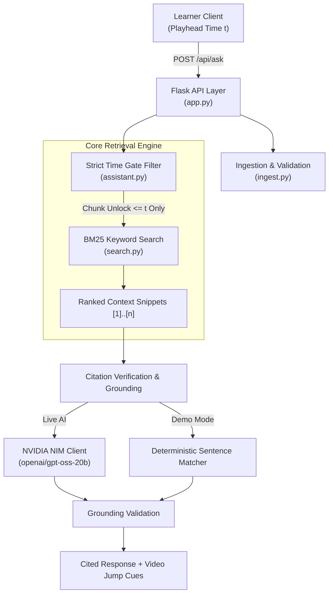

# LearnMate AI

> **Interactive Video Learning Companion**: Ask questions while lecture videos play and receive cited, spoiler-free answers strictly restricted to content up to your current playback time. Includes adaptive AI tutoring, lecture summaries, concept comparison, smart quizzes, document parsing (PDF, PPTX, DOCX, TXT), and mock interviews with explainable scorecards.

Powered by a lightweight, clean architecture: **HTML5, CSS3, Vanilla JS, Python Flask, BM25 Keyword Search, PyMuPDF, python-pptx, and NVIDIA NIM (`openai/gpt-oss-20b`)** or any OpenAI-compatible provider.

---

## 🚀 Quickstart (No API Key Required)

Run the fully offline demo in under 2 minutes:

```bash
python -m venv .venv
# Windows:
.venv\Scripts\activate
# macOS/Linux:
source .venv/bin/activate

pip install -r requirements.txt
python app.py
```
Open **http://127.0.0.1:5000** in your browser.

- You start in **Demo Mode**: all answers, quizzes, and study tools run offline using the bundled lecture (*"Python Lists"* — 8 video segments + synchronized lecture notes and slides).
- Offline answers extract exact sentences from the lecture transcript and provide timestamp jump citations.

---

## ⚡ Enable Real AI (NVIDIA NIM or Any Provider)

1. Copy `.env.example` to `.env`:
   ```bash
   cp .env.example .env
   ```
2. Configure your credentials in `.env`:
   ```ini
   LLM_API_KEY=your_nvidia_api_key_here
   LLM_BASE_URL=https://integrate.api.nvidia.com/v1
   LLM_MODEL=openai/gpt-oss-20b
   ```
3. Restart `python app.py`. The assistant automatically activates live AI intelligence.

---

## 🎬 What to Try (Judge Walkthrough)

1. **Spoiler-Safe Playback Test**:
   - Open the lecture module.
   - At timestamp `0:30`, ask: *"How do I add an item to a list?"*
   - **Result**: Polite refusal (*"That hasn't been covered yet in what you've watched so far! Please keep watching the video to reach this topic."* — taught at 1:30).
   - Advance playhead past `1:40` and ask again: instant cited explanation with a `[1]` badge. Click the badge to jump the player to that exact cue.
2. **YouTube Video & Auto-Subtitles**:
   - Create a new course with a YouTube link (e.g. `https://www.youtube.com/watch?v=...`).
   - Leave the subtitle file empty: LearnMate extracts captions and builds timestamped cues automatically.
3. **Upload Your Own Materials**:
   - In **Documents**, upload a `.pdf`, `.pptx`, `.docx`, or `.txt` file.
   - Query your syllabus or slides directly with exact page/slide citations.
4. **Adaptive Mock Interview**:
   - Open the **Interview** tab.
   - Answering with gaps generates an adaptive follow-up. A strong answer progresses to a higher-level question.
   - Upon completion, view the explainable scorecard detailing covered competencies and revision gaps.

---

## 🛡️ Core Architecture & Integrity Guarantees



| Guarantee | Technical Implementation |
|:---|:---|
| **Zero Spoilers / Time-Gated** | Chunks are filtered *before* search. Any cue with `unlock > current_time` is strictly excluded from context. |
| **No Hallucinated Citations** | The verification engine discards fabricated source numbers and attaches only verified retrieved chunks. |
| **Unsupported Questions** | Questions lacking keyword overlap return polite refusals without calling the LLM, preventing hallucinations and conserving tokens. |
| **Secret Isolation** | API credentials live exclusively on the backend / `.env`, are scrubbed from all error logs, and are never exposed in client bundles. |
| **Upload Safety** | Magic-byte checks, zip-bomb size checks, and sanitized temporary file handlers defend against corrupted or malicious uploads. |

---

## 🚢 Deployment Guide

LearnMate uses lightweight JSON persistence organized by anonymous session tokens in `data/users/<uid>/`.

### Option A: Render (Recommended)
- **Service Type**: Web Service
- **Environment**: Python
- **Build Command**: `pip install -r requirements.txt`
- **Start Command**: `gunicorn app:app --bind 0.0.0.0:$PORT --workers 1 --threads 4 --timeout 120`
- **Environment Variables**:
  - `LLM_API_KEY`: Your NVIDIA NIM or provider key
  - `LLM_BASE_URL`: `https://integrate.api.nvidia.com/v1`
  - `LLM_MODEL`: `openai/gpt-oss-20b`
  - `SECRET_KEY`: A cryptographically random hex string
  - `COOKIE_SECURE`: `1`
- *Note*: Use 1 worker to preserve in-process rate limiting and file lock coordination. For multi-month course retention across restarts, attach a Render Persistent Disk mounted to `DATA_DIR`.

### Option B: VPS / Docker
Run behind Nginx with SSL termination. Set `COOKIE_SECURE=1` and ensure the storage directory has appropriate read/write permissions.

---

## 🧪 Test Suite

Run the full automated test suite:

```bash
python -m pytest
```

**Results**:
- 80 automated unit and integration tests passing.
- Validates YouTube timestamp boundaries, `.docx`/`.pdf`/`.pptx` parsing, BM25 indexing, LLM cache partitioning, CSRF headers, and rate-limiting.
