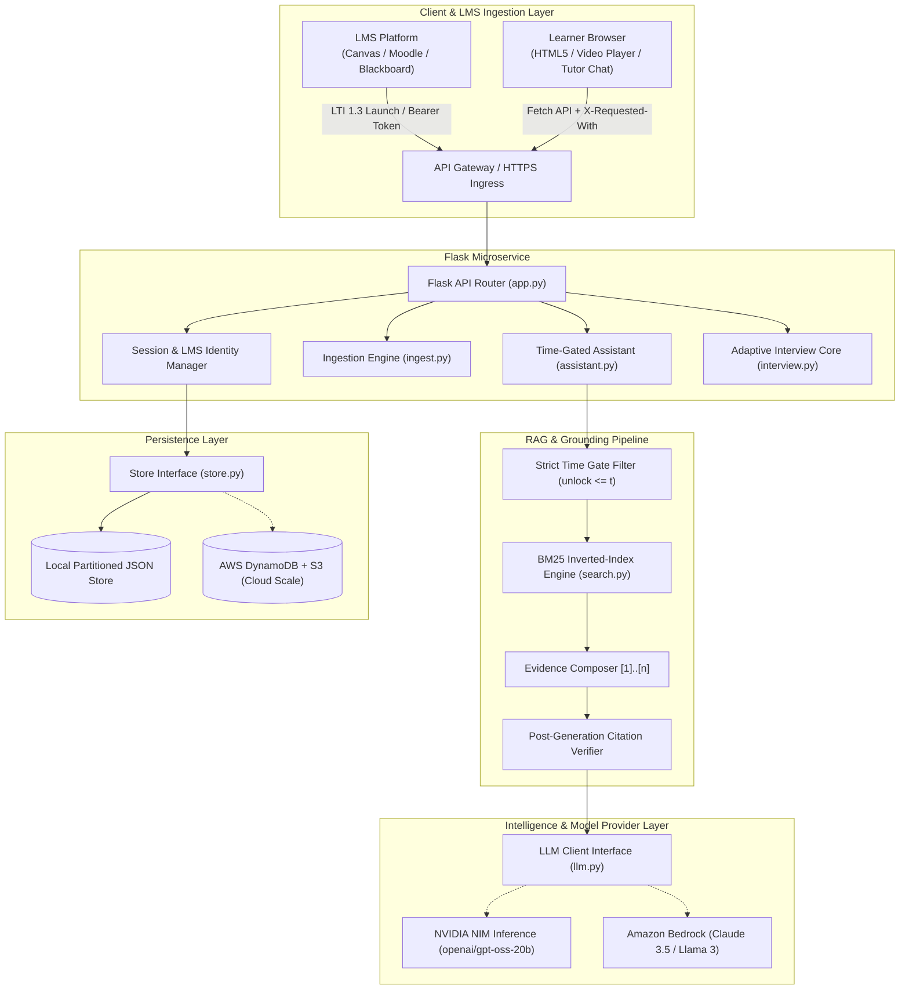

# LearnMate Enterprise Architecture

LearnMate AI is an **API-driven, modular learning microservice** designed for immediate standalone operation and clean integration into enterprise Learning Management Systems (LMS) such as Canvas, Moodle, and Blackboard.

---

## 1. System Architecture Overview

---

## 2. AWS-First Enterprise Migration Blueprint

The hackathon architecture encourages an **AWS-first design**. Because LearnMate was built with strict interface boundaries, every internal module maps directly to an AWS enterprise service without altering business logic:

| LearnMate Component | Local Implementation (Current) | AWS Enterprise Target | Why This Service Fits |
|:---|:---|:---|:---|
| **Video & Document Storage** | `data/users/<uid>/media/` | **Amazon S3** | Encrypted, durable object storage with pre-signed URLs for media playback and syllabus uploads. |
| **Speech-to-Text Transcripts** | `youtube-transcript-api` / Local `.srt` | **Amazon Transcribe** | Generates timestamped word-level cues directly from uploaded audio/video files. |
| **Time-Gated Search Index** | BM25 Inverted Index (`search.py`) | **Amazon OpenSearch Serverless** | Scalable vector and BM25 hybrid search with native timestamp filter queries. |
| **Learner State & Grade Store** | Partitioned JSON files (`store.py`) | **Amazon DynamoDB** | Single-digit millisecond latency for concurrent student sessions, quiz scores, and watch positions. |
| **Inference Engine** | NVIDIA NIM Client (`llm.py`) | **Amazon Bedrock** | Serverless foundation model access (Claude 3.5 Sonnet / Llama 3) with zero infrastructure management. |
| **Microservice Compute** | Gunicorn / Flask Container | **AWS ECS Fargate / Lambda** | Auto-scaling containerized execution responding to LMS traffic surges. |
| **Telemetry & Observability** | Python `logging` module | **Amazon CloudWatch** | Centralized logs, error rate alerts, and inference latency dashboards. |
| **Concept Relationship Graph** | Concept comparison (`assistant.py`) | **Amazon Neptune** | Prerequisite concept dependency trees and knowledge graph navigation. |

---

## 3. LMS Integration Architecture

LearnMate features native LMS integration routes:

1. **`POST /api/lms/launch`**:
   - Accepts LMS learner launch payloads (`lms_user_id`, `lms_course_id`, `role`).
   - Automatically scopes learner progress, preventing cross-tenant leakage between university sections.
2. **`GET /api/lms/export/<course_id>`**:
   - Exports gradebook sync payloads including lecture completion percentages, quiz scores, and adaptive interview competencies.
   - Compatible with Canvas Gradebook API and LTI Advantage Assignment and Grade Services (AGS).

---

## 4. Concurrency & Security Model

- **Zero-Storage Leaks**: All student data is isolated by user token in partitioned storage paths.
- **CSRF & Traversal Defense**: Enforces custom request headers (`X-Requested-With: fetch`) and strict regex validation on user identifiers.
- **Process Concurrency**: Gunicorn thread worker model (`--workers 1 --threads 4`) prevents race conditions while serving multiple concurrent learners.
