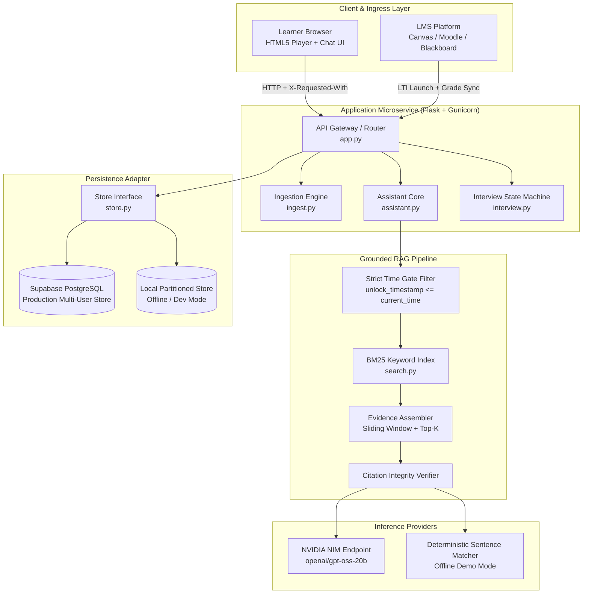

# Architecture and System Design

LearnMate is an API-driven learning microservice that enforces timestamp-restricted retrieval over recorded lectures and supporting academic documents.

---

## 1. System Overview

---

## 2. Ingestion and Retrieval Pipeline

### Document and Caption Ingestion
1. Video captions are loaded from user-uploaded `.srt` or `.vtt` files, or automatically extracted via the YouTube Transcript API. Captions are segmented into semantic time-stamped cues.
2. Documents (.pdf, .pptx, .docx, .txt) are parsed page-by-page or slide-by-slide:
   - PDFs are extracted via PyMuPDF (`fitz`), preserving physical page boundaries.
   - Slide decks are parsed using `python-pptx`, capturing slide titles, body shapes, notes frames, and table cells.
   - Word documents (`.docx`) are extracted through XML paragraph and table run inspection.
3. Every chunk records metadata: `type`, `ref` (page number, slide number, or time boundary), `label`, and `unlock` timestamp.

### Strict Playhead Time-Gating
Retrieval enforces timestamp isolation prior to searching:
- When a user asks a question at playback time `t`, chunks with `unlock > t` are pruned before reaching the BM25 index.
- Future transcript lines and unviewed document sections never enter the language model context window.
- If the BM25 index does not retrieve evidence meeting the keyword overlap threshold, the system immediately returns a structured refusal (`"status": "not_found"`), avoiding unnecessary inference latency and hallucination.

### Citation Integrity Verification
Post-generation verification validates every citation tag (such as `[1]`, `[2]`) in the model response against the retrieved context snippets:
- Citations referring to sources not in the retrieved set are stripped.
- Citations are converted to structured metadata objects linking directly to video seek timestamps or document page numbers.

---

## 3. Persistence and Multi-User Concurrency

### Dual-Mode Persistence Layer (`store.py`)
LearnMate implements an abstract key-value and object store:
- **Cloud Mode (`DATABASE_URL` configured)**: Automatically establishes a pooled connection to PostgreSQL (e.g. Supabase or Neon) and maintains the table `learnmate_kv`. Courses, document records, interview states, and quiz scores persist permanently across server restarts or ephemeral container replacement.
- **Local Mode (`DATABASE_URL` omitted)**: Falls back to thread-locked JSON files under `data/users/<uid>/`. Writes use reentrant locks (`threading.RLock`) and atomic file replacement (`.tmp` write followed by `os.replace`).

### Session Scoping and Rate Limiting
- Each browser session receives an encrypted, HTTP-only cookie holding an anonymous user identifier (`uid`).
- Token-bucket rate limiting enforces a maximum of 30 requests per minute per user.
- Daily AI usage is capped at 100 calls per user, preventing automated quota exhaustion.
- Gunicorn runs with multiple worker processes to handle concurrent student sessions.

---

## 4. AWS-First Enterprise Migration Blueprint

Every module in LearnMate uses strict interface boundaries, allowing zero-downtime migration to native AWS cloud services:

| Component | Current Implementation | AWS Target Service | Architectural Rationale |
| :--- | :--- | :--- | :--- |
| **Media Storage** | Local `/media/` filesystem | **Amazon S3** | Durable, encrypted object storage with pre-signed URLs for media streaming and syllabus uploads. |
| **Speech-to-Text** | `youtube-transcript-api` / local `.srt` | **Amazon Transcribe** | Converts instructor speech in uploaded videos into word-level timestamped captions. |
| **Search Engine** | In-memory BM25 index (`search.py`) | **Amazon OpenSearch Serverless** | Scalable hybrid keyword and vector retrieval with native timestamp filter expressions. |
| **User State** | PostgreSQL / local JSON (`store.py`) | **Amazon DynamoDB** | Single-digit millisecond latency key-value storage partitioned by student identity. |
| **Inference** | NVIDIA NIM API (`llm.py`) | **Amazon Bedrock** | Serverless foundation model execution (Claude 3.5 Sonnet / Llama 3) with enterprise security boundaries. |
| **Compute** | Gunicorn / Flask container | **AWS ECS Fargate / Lambda** | Auto-scaling containerized microservice execution matching lecture schedule spikes. |
| **Observability** | Structured Python logging | **Amazon CloudWatch** | Aggregated application logs, error tracing, and model latency dashboards. |
| **Concept Graph** | Concept comparison module | **Amazon Neptune** | Graph database for managing prerequisite concept trees and learning dependency paths. |

---

## 5. Learning Management System (LMS) Integration

LearnMate provides direct compatibility routes for university LMS platforms:
1. **LTI 1.3 Launch Handler (`POST /api/lms/launch`)**:
   - Ingests learner launch tokens containing student identifiers, course codes, and roles.
   - Isolates learner data by institutional tenant, preventing cross-course leakage.
2. **Gradebook Sync Handler (`GET /api/lms/export/<course_id>`)**:
   - Outputs completion percentages, quiz scores, and interview performance metrics.
   - Directly maps to Canvas, Moodle, and Blackboard Gradebook APIs.
